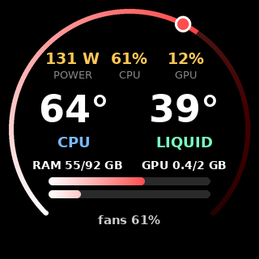
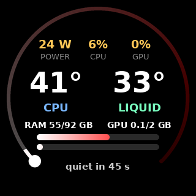

# kraken-display-linux

A small Linux service that runs an **NZXT Kraken Z** AIO (Z53 / Z63 / Z73), an **NZXT Smart Device V2** fan/LED hub and **RAM lights** (through OpenRGB) as one system, driven by CPU load and temperatures. Built for a headless 24x7 server, where NZXT CAM is not available.

<p align="center">
  
  &nbsp;&nbsp;
  
</p>

## What it does

- **Modes by CPU load.** By default: `idle`, `light`, `active`, `busy`, `heavy`, `max`. A mode goes up after the load has stayed higher for 1 minute, and steps back down one mode at a time over 3 minutes, so short bursts don't make the fans jump. Each mode sets the light color and brightness, the pump screen brightness and a minimum fan and pump speed.
- **Fans and pump** each run at the highest of: their liquid-temperature curve, a CPU-temperature boost, and the current mode's minimum. They speed up fast and slow down gently.
- **Quiet mode.** After a minute of near-zero load, all fans drop to a low fixed speed and the lights and screen dim. Lasting load or rising temperatures wake it up (temperatures immediately).
- **Dark mode.** Optionally keep all lights off and the pump screen black below a chosen mode, so the PC is only lit while it's working hard.
- **Pump screen (320x320 LCD):** CPU power, CPU and GPU load, CPU and liquid temperatures, RAM and GPU memory bars, and a gradient gauge with a dot on the current mode. The dot glides toward the next mode while a change is pending. The bottom line cycles through fan speed, the coming mode change, a quiet countdown, pump speed or the clock.
- **Safe on stop.** When the service stops, the Kraken is put back on its own liquid-temperature curves, so the fans and pump never stay stuck at a fixed speed.
- **Robust.** The NZXT devices sometimes drop a USB reply; every command is retried, and the hub and OpenRGB reconnect on their own.
- **Status file** for a quick look: `watch -n2 cat /run/kraken-display/status.txt`

```
23:42:57   mode: busy
CPU 64 C (smoothed 63)   load 59% (smoothed 61%)   CPU power 128 W
liquid 38.6 C   pump 79% (2409 rpm)   RAM 87.7/92 GB   fan boost 55%
GPU (nvidia) load 0%   memory 0.0/2.0 GB
  radiator pull fans 1-2 (Kraken)         61%   1298 rpm
  radiator push fans 1-2 (hub fan1)       61%   1204 rpm
  rear case fan (hub fan2)                55%   1142 rpm
  top case fan (hub fan3)                 55%    768 rpm
lights #b83737 at 72%   screen 76%   RAM lights: 2 stick(s)
```

## Hardware

| Device | Needed | Used for |
|---|---|---|
| NZXT Kraken Z53 / Z63 / Z73 | yes | pump, radiator fans, liquid temperature, LCD |
| NZXT Smart Device V2 | no | three fan channels and the LED strips (skipped if not found) |
| RAM or other lights supported by [OpenRGB](https://openrgb.org) | no | lights follow the mode color (skipped if no OpenRGB server) |

Sensors: CPU temperature from `coretemp` (Intel) or `k10temp` / `zenpower` (AMD; with no CPU sensor the temperature boost is off and quiet mode never starts), CPU package power from Intel RAPL (shown as `--` if missing), GPU load and memory from `nvidia-smi`, AMD `amdgpu` sysfs, or Intel built-in graphics.

Developed and used 24x7 on an Intel Core i9-12900K with a Kraken Z63 and a Smart Device V2, on Ubuntu. Other setups should work but are untested; reports and pull requests are welcome.

On stop (`systemctl stop`, SIGTERM) the Kraken's radiator fans and pump go back to their liquid curves, which the Kraken then runs by itself, and the Smart Device fans are set to 60% (the hub has no curve of its own).

## Install

Needs Python 3.10+ and root (or udev rules giving your user access to the NZXT USB devices).

```sh
sudo apt install python3-pil fonts-dejavu-core    # or: pip install Pillow
sudo pip install liquidctl openrgb-python          # or your distro's packages

sudo mkdir -p /opt/kraken
sudo cp kraken_display.py /opt/kraken/
sudo cp kraken-display.example.json /etc/kraken-display.json   # optional, defaults are built in

sudo cp systemd/kraken-display.service /etc/systemd/system/
sudo systemctl daemon-reload
sudo systemctl enable --now kraken-display
```

**Newer kernels:** Linux ships an `nzxt_kraken3` hwmon driver that claims the Kraken, and then liquidctl can't control it. Block it and reboot (or `sudo rmmod nzxt_kraken3`):

```sh
echo "blacklist nzxt_kraken3" | sudo tee /etc/modprobe.d/no-kraken3.conf
```

The Smart Device V2's driver (`nzxt_smart2`) can stay loaded; it works alongside liquidctl.

For RAM lights, also install OpenRGB and enable `systemd/openrgb-server.service` (the SDK server listens on `127.0.0.1:6742` only).

Check it:

```sh
journalctl -u kraken-display -f
watch -n2 cat /run/kraken-display/status.txt
```

## Settings

Everything is in `/etc/kraken-display.json` (another path: `--config PATH` or `KRAKEN_DISPLAY_CONFIG`). Every section has a `_help` entry explaining its settings. Anything missing or invalid falls back to the built-in default, with a note in the log, so a typo never leaves the fans uncontrolled.

```sh
python3 kraken_display.py --print-config     # the settings in use
sudo systemctl restart kraken-display        # after editing
```

The main sections:

- `modes.list`: the modes, each with `load_to` (upper CPU load %), `color`, `lights` %, `screen` %, `fan_min` % and `pump_min` %. Add, remove or rename freely.
- `modes.up_after_min` / `modes.down_after_min`: how long before a mode goes up / how long the step-down takes.
- `fans`: liquid-temperature curves for the radiator fans, case fans and pump (`[liquid C, duty %]` points), the CPU temperature boost, smoothing and ramp speeds, and the names shown in the status file.
- `quiet`: when quiet mode starts and ends, and the fan and pump speeds in it.
- `dark.show_from`: the first mode with lights and screen on (the first mode's name = always on).
- `lights.mode`: `auto` or `off`.
- `screen`: rotation, update interval, and what the bottom line shows.

**Pump speed:** the Kraken won't go below 20 %. The built-in default keeps the pump at 80 % or more, as NZXT advises against running it slow for long periods; lower `fans.pump_curve`, `quiet.pump_duty` and the modes' `pump_min` only if you accept that trade-off.

## License

[MIT](LICENSE). Not affiliated with NZXT. Device control is done by [liquidctl](https://github.com/liquidctl/liquidctl); use at your own risk.
